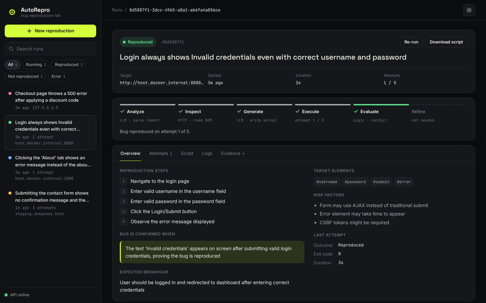

# AutoRepro 🤖🐛

An AI-powered debugging assistant that converts natural-language bug reports into verified **Selenium reproduction scripts** via an autonomous LangGraph agent loop — fully runnable inside an isolated Docker sandbox.

---

## Overview

AutoRepro accepts a bug report (e.g., *"Login always shows Invalid credentials even with correct username and password"*) and autonomously **analyzes → inspects DOM → generates → executes → evaluates → refines** a Selenium browser-automation script until the bug is reliably reproduced — or the maximum number of attempts is exhausted.

### Core Features

- 🧠 **Multi-LLM support** — AWS Bedrock (Claude), Google Gemini (free), Anthropic Claude, OpenAI GPT, Ollama (local)
- 🔍 **DOM Inspection** — Fetches real page HTML and extracts interactive elements, giving the LLM actual CSS selectors instead of guessing
- 🔄 **Autonomous self-refinement loop** — up to 5 attempts with intelligent error diagnosis
- 🐳 **Isolated Docker sandboxes** — Chromium + Selenium in memory-limited containers
- 🌐 **Web UI dashboard** — run list with search & filters, live pipeline progress, per-attempt drill-down, script/logs/evidence tabs, dark & light themes
- 📸 **Proof of Execution Timeline** — step-by-step screenshot evidence captured from real browser sessions
- 🔒 **AST-based security scanning** — blocks dangerous imports/builtins before execution
- 📁 **Artifact API** — download generated scripts & screenshots via REST
- 🔐 **`.env` configuration** — API keys stored securely, never exposed in terminal commands

---

## Architecture

### Pipeline Flow

```
┌───────────────────────────────────────────────────────────────────────────┐
│                         AutoRepro Agent Loop                              │
│                                                                           │
│   Bug Report ──▶ ANALYZE ──▶ INSPECT ──▶ GENERATE ──▶ EXECUTE ──▶ EVAL  │
│                   (LLM)      (HTTP)      (LLM)      (Docker)    (Logic)  │
│                                                                   │       │
│                                                        ┌──────────┴─────┐ │
│                                                        ▼                ▼ │
│                                                   ✅ Success       ❌ REFINE│
│                                                   (save result)     (LLM)│
│                                                                      │   │
│                                                                      ▼   │
│                                                                  EXECUTE │
│                                                                  (retry) │
└───────────────────────────────────────────────────────────────────────────┘
```

### Node Descriptions

| Node | Type | Description |
|------|------|-------------|
| **Analyze** | LLM | Parses bug report into structured JSON: inferred steps, target CSS selectors, success condition, risk factors |
| **Inspect** | HTTP | Fetches the target URL with `requests` + `BeautifulSoup`, extracts all interactive elements (`<a>`, `<button>`, `<input>`, `<form>`, etc.) with their real IDs, classes, text content, and attributes. Passes this DOM context to the LLM — **no API credits consumed** |
| **Generate** | LLM | Writes a complete Python/Selenium script using real DOM selectors. Includes JS-based page reload detection, complete imports, and screenshot evidence capture |
| **Execute** | Docker | Writes script to disk, runs it inside an isolated Docker container with headless Chromium. Captures stdout, stderr, exit code, screenshots |
| **Evaluate** | Deterministic | Parses the script's single `AUTOREPRO_RESULT` JSON line and requires a clean exit. Classifies failures: `BugNotObserved`, `WrongVerification`, `Timeout`, `ElementNotFound`, `NetworkError`, `SyntaxError`, `SecurityViolation`, `Unknown` |
| **Refine** | LLM | Receives the original bug report, failed script, execution result, DOM context, and full attempt history. Diagnoses the issue and rewrites the script. After two differing strategies it may conclude the bug is absent, which ends the run |

### State Machine (LangGraph)

```python
graph = StateGraph(AgentState)
graph.add_node("analyze",  analyze_node)
graph.add_node("inspect",  inspect_node)   # DOM inspection (NEW)
graph.add_node("generate", generate_node)
graph.add_node("execute",  execute_node)
graph.add_node("evaluate", evaluate_node)
graph.add_node("refine",   refine_node)

# Flow: analyze → inspect → generate → execute → evaluate → (success | refine → execute)
graph.set_entry_point("analyze")
graph.add_edge("analyze",  "inspect")
graph.add_edge("inspect",  "generate")
graph.add_edge("generate", "execute")
graph.add_edge("execute",  "evaluate")
graph.add_conditional_edges("evaluate", route_after_evaluate, {
    "end_success": END,
    "refine":      "refine",
    "end_failure": END,
})
graph.add_edge("refine", "execute")
```

### LLM API Usage Per Job

Not all pipeline steps consume LLM API credits:

| Step | Uses LLM? | Cost |
|------|-----------|------|
| Analyze | ✅ Yes | ~500 input + 200 output tokens |
| Inspect | ❌ No (HTTP fetch) | **Free** |
| Generate | ✅ Yes | ~2000 input + 500 output tokens |
| Execute | ❌ No (Docker) | **Free** |
| Evaluate | ❌ No (string check) | **Free** |
| Refine | ✅ Yes (per retry) | ~2500 input + 500 output tokens |
| Screenshots | ❌ No (Selenium) | **Free** |

**Best case** (succeeds on attempt 1): 2 LLM calls, ~3,200 tokens  
**Worst case** (all 5 attempts fail): 6 LLM calls, ~15,200 tokens

---

## Tech Stack

| Component | Technology | Details |
|-----------|------------|---------|
| Agent Framework | **LangGraph** | State machine with conditional edges for the refine loop |
| LLM Providers | **AWS Bedrock** (recommended), Google Gemini (free), Anthropic, OpenAI, Ollama | Configurable via `.env` |
| DOM Inspector | **BeautifulSoup** + requests | Real element extraction — no LLM credits used |
| Backend API | **FastAPI** + Uvicorn | Async endpoints, background task execution |
| Sandbox | **Docker** | Headless Chromium + Selenium 4.18 in isolated containers |
| Security | AST allow-list + container hardening | Only `selenium`, `json`, `time`, `re` and a short list of stdlib modules; `cap_drop=ALL`, no-new-privileges, pids limit |
| Frontend | Vanilla **HTML/CSS/JS** | No build step; Inter, Space Grotesk + JetBrains Mono; dark/light themes; hash routing (`#/job/<id>`) |
| Testing | **Pytest** | Unit tests + integration tests with mock LLM |
| Logging | **structlog** | Structured JSON logging |

---

## Project Structure

```
Bug_Reproducer/                   # Repository root
├── Dockerfile                    # API container image (Python 3.11 + uvicorn)
├── docker-compose.prod.yml       # Production Docker Compose (API + sandbox build)
├── .env.production.template      # Template for production .env.production
├── setup.sh                      # One-command EC2 setup script
├── pyproject.toml                # ruff configuration
├── .github/workflows/ci.yml      # Tests, lint, image builds, shellcheck
├── docs/analysis/                # Independent review + verify_bugs.py regression checklist
│
└── autorepro/                    # Python application
    ├── agent/                    # LangGraph agent (core logic)
    │   ├── common.py             # Verdict parsing, fence stripping, URL fixing (shared)
    │   ├── graph.py              # State machine wiring & conditional edges
    │   ├── orchestrator.py       # Public entrypoint — runs full agent loop
    │   ├── state.py              # AgentState TypedDict & FailureType enum
    │   └── nodes/                # Individual pipeline stages
    │       ├── analyze.py        # Node 1: LLM bug report → structured JSON
    │       ├── inspect.py        # Node 2: HTTP fetch → DOM element extraction
    │       ├── generate.py       # Node 3: LLM → Selenium script
    │       ├── execute.py        # Node 4: Run script in Docker sandbox
    │       ├── evaluate.py       # Node 5: Deterministic success/failure classifier
    │       └── refine.py         # Node 6: LLM rewrites script on failure
    │
    ├── api/                      # FastAPI REST application
    │   ├── main.py               # App factory, CORS, static file serving
    │   ├── routes.py             # Endpoint handlers
    │   └── schemas.py            # Pydantic request/response models
    │
    ├── prompts/                  # LLM prompt templates
    │   ├── analyze.txt
    │   ├── generate.txt
    │   └── refine.txt
    │
    ├── sandbox/                  # Docker sandbox engine
    │   ├── Dockerfile            # Chromium + chromedriver + Selenium image
    │   ├── runner.py             # Container lifecycle management
    │   ├── security.py           # AST-based static analysis
    │   └── feedback_parser.py    # Normalises Docker logs → ExecutionResult
    │
    ├── static/                   # Web UI (served by FastAPI)
    │   ├── index.html
    │   ├── style.css
    │   └── app.js
    │
    ├── storage/
    │   ├── jobs.py               # JSON file-based job store
    │   └── artifacts.py          # Script & screenshot management
    │
    ├── tests/
    │   ├── demo_server.py        # Buggy login demo app (Flask)
    │   └── test_bug_fixes.py     # Pytest suite
    │
    ├── utils/
    │   ├── config.py             # Central config (reads .env)
    │   ├── net.py                # SSRF guard for server-side target fetches
    │   ├── logger.py             # structlog setup
    │   ├── id_generator.py       # UUID job ID generator
    │   └── mock_llm.py           # Mock LLM for offline testing
    │
    ├── data/                     # Runtime data (gitignored)
    │   ├── jobs/
    │   └── artifacts/
    │
    ├── .env                      # Local config (gitignored)
    └── requirements.txt
```

---

## Setup & Running

### Prerequisites

- **Python 3.11+**
- **Docker Desktop** (daemon must be running)
- **An LLM provider** — one of the options below

### Step 1: Clone & Install Dependencies

```bash
git clone https://github.com/Inward17/Bug_Reproducer.git
cd Bug_Reproducer/autorepro
```

**Create and activate a virtual environment:**

```bash
python -m venv venv
```

```bash
# Windows (PowerShell)
venv\Scripts\activate

# macOS / Linux
source venv/bin/activate
```

```bash
pip install -r requirements.txt
```

For local tests or demo-mode tooling, install the dev extras instead:

```bash
pip install -r requirements-dev.txt
```

### Step 2: Build the Docker Sandbox Image

```bash
# Run from inside autorepro/
docker build -t autorepro-sandbox:latest .\sandbox
```

> Creates a slim Python 3.11 image with headless Chromium + chromedriver + Selenium. Scripts run in an isolated container with 512MB memory limit and a non-root user (UID 1000).

### Step 3: Configure Your LLM Provider

Create a `.env` file inside `autorepro/`:

```bash
# Windows
copy NUL .env

# macOS / Linux
touch .env
```

Then paste your chosen provider config (see **LLM Provider Configuration** section below).

### Step 4: Start the Application

```bash
# From inside autorepro/ with venv active
python -m uvicorn api.main:app --port 8000
```

> Everything is read from `.env` automatically — no CLI env vars needed.

### Step 5: Open the Web UI

Navigate to **http://localhost:8000** in your browser.

---

## LLM Provider Configuration

All configuration is done in the `.env` file. Choose **one** provider:

### Option A: Google Gemini (Free — Recommended for Getting Started)

```env
LLM_PROVIDER=google
LLM_MODEL=gemini-2.5-flash-lite
GOOGLE_API_KEY=your-google-api-key
```

**Setup:**
1. Go to [aistudio.google.com](https://aistudio.google.com)
2. Click **"Get API Key"** → Create key (free, no credit card)
3. Paste the key in `.env`

> **Free tier:** 1,000 requests/day, 250,000 tokens/minute. More than enough for testing.

### Option B: AWS Bedrock (Claude — Recommended for Production)

```env
LLM_PROVIDER=bedrock
LLM_MODEL=anthropic.claude-3-5-haiku-20241022-v1:0
AWS_ACCESS_KEY_ID=AKIA...
AWS_SECRET_ACCESS_KEY=your-secret-key
AWS_DEFAULT_REGION=us-east-1
```

**Setup:**
1. You need AWS IAM credentials (Access Key ID + Secret Access Key)
2. Ensure Bedrock model access is enabled in your AWS region
3. For Anthropic models, a one-time use case form submission is required:

```python
# Run once to submit the Anthropic use case form
python -c "
from dotenv import load_dotenv; load_dotenv()
import os, boto3, json
client = boto3.client('bedrock',
    region_name=os.getenv('AWS_DEFAULT_REGION', 'us-east-1'),
    aws_access_key_id=os.getenv('AWS_ACCESS_KEY_ID'),
    aws_secret_access_key=os.getenv('AWS_SECRET_ACCESS_KEY'))
client.put_use_case_for_model_access(formData=json.dumps({
    'companyName': 'Your Company',
    'companyWebsite': 'https://your-site.com',
    'intendedUsers': '0',
    'industryOption': 'Technology',
    'otherIndustryOption': '',
    'useCases': 'Automated bug reproduction testing tool'
}))
print('Done! Access granted immediately.')
"
```

4. Then create the model agreement:

```python
python -c "
from dotenv import load_dotenv; load_dotenv()
import os, boto3
client = boto3.client('bedrock',
    region_name=os.getenv('AWS_DEFAULT_REGION', 'us-east-1'),
    aws_access_key_id=os.getenv('AWS_ACCESS_KEY_ID'),
    aws_secret_access_key=os.getenv('AWS_SECRET_ACCESS_KEY'))
offers = client.list_foundation_model_agreement_offers(
    modelId='anthropic.claude-3-5-haiku-20241022-v1:0')
token = offers['offers'][0]['offerToken']
client.create_foundation_model_agreement(
    modelId='anthropic.claude-3-5-haiku-20241022-v1:0',
    offerToken=token)
print('Model agreement created!')
"
```

> **Important:** Your AWS account must have a valid payment method configured for AWS Marketplace.

**Available Bedrock models:**
| Model ID | Description |
|----------|-------------|
| `anthropic.claude-3-haiku-20240307-v1:0` | Fast & cheap (~$0.006/job) |
| `anthropic.claude-3-5-haiku-20241022-v1:0` | Smarter, still affordable (~$0.01/job) |
| `anthropic.claude-3-5-sonnet-20241022-v2:0` | Best quality (~$0.08/job) |

### Option C: Direct Anthropic API

```env
LLM_PROVIDER=anthropic
LLM_MODEL=claude-3-haiku-20240307
ANTHROPIC_API_KEY=sk-ant-api03-...
```

### Option D: OpenAI

```env
LLM_PROVIDER=openai
LLM_MODEL=gpt-4o
OPENAI_API_KEY=sk-...
```

### Option E: Ollama (Local — No API Key Needed)

```env
LLM_PROVIDER=ollama
LLM_MODEL=qwen2.5-coder:3b
```

**Setup:**
1. Install Ollama from [ollama.com](https://ollama.com)
2. Pull a model: `ollama pull qwen2.5-coder:3b`
3. Ollama must be running before starting AutoRepro

> **Note:** Local 3B models work for simple test pages but struggle with complex real-world websites. For production use, a cloud LLM provider is strongly recommended.

---

## Environment Variables

| Variable | Default | Description |
|----------|---------|-------------|
| `LLM_PROVIDER` | `ollama` | LLM provider: `bedrock`, `google`, `anthropic`, `openai`, `ollama`, `auto` (try each in turn), `mock` (offline tests) |
| `LLM_MODEL` | `qwen2.5-coder:3b` | Model name/ID for the chosen provider |
| `BEDROCK_MODEL` / `ANTHROPIC_MODEL` / `GOOGLE_MODEL` / `OLLAMA_MODEL` | `LLM_MODEL` | Per-provider override, used by `LLM_PROVIDER=auto` |
| `OLLAMA_NUM_CTX` | `16384` | Context window requested from Ollama; its own default silently truncates the prompts |
| `AWS_ACCESS_KEY_ID` | — | AWS credentials (for Bedrock provider) |
| `AWS_SECRET_ACCESS_KEY` | — | AWS credentials (for Bedrock provider) |
| `AWS_DEFAULT_REGION` | `us-east-1` | AWS region (for Bedrock provider) |
| `GOOGLE_API_KEY` | — | API key (for Google Gemini provider) |
| `ANTHROPIC_API_KEY` | — | API key (for Anthropic provider) |
| `OPENAI_API_KEY` | — | API key (for OpenAI provider) |
| `MAX_ATTEMPTS` | `5` | Maximum refinement attempts per job |
| `SANDBOX_TIMEOUT_SECONDS` | `60` | Timeout for each Docker script execution |
| `SANDBOX_MEMORY_MB` | `512` | Memory limit for Docker sandbox containers |
| `SANDBOX_IMAGE` | `autorepro-sandbox:latest` | Docker image name for the sandbox |
| `SANDBOX_PIDS_LIMIT` | `256` | Process limit inside a sandbox container |
| `SANDBOX_READ_ONLY` | `false` | Read-only rootfs + tmpfs for the sandbox. Verified with the bundled image; recheck if you change the Chromium build |
| `MAX_CONCURRENT_SANDBOXES` | `4` | Sandbox containers allowed to run at once |
| `API_KEY` | — | When set, every API call needs a matching `X-API-Key` header |
| `CORS_ORIGINS` | — | Comma-separated origins allowed to call the API from a browser. Empty means none; the bundled UI is same-origin |
| `ALLOW_PRIVATE_TARGETS` | `true` | Allow targets on private/loopback addresses. Set `false` in production. Link-local and cloud metadata addresses are always refused |
| `HOST_DATA_DIR` | — | Host path of `DATA_DIR`, required when the API itself runs in a container |
| `DATA_DIR` | `./data` | Directory for job data & artifacts |
| `LOG_LEVEL` | `INFO` | Logging level |
| `DEMO_MODE` | `false` | Simulate execution without Docker or a browser. Clearly marked in the API and UI, and never real evidence |

---

## API Endpoints

| Method | Endpoint | Description |
|--------|----------|-------------|
| `POST` | `/reproduce` | Submit a bug report for reproduction. Body: `{"bug_report": "...", "target_url": "..."}` |
| `GET` | `/result/{job_id}` | Get job status, live `stage`, per-attempt details (`attempts`), `analysis`, `error`, and script |
| `GET` | `/result/{job_id}/script` | Download the final generated Selenium script |
| `GET` | `/result/{job_id}/screenshot/{filename}` | View a captured screenshot |
| `GET` | `/jobs` | List all jobs (full records). `?summary=true` returns light rows, newest first |
| `GET` | `/health` | Pings the Docker daemon. `200` when usable, `503` with `docker_error` when not |
| `GET` | `/` | Serve the Web UI |

---

## How Bug Reproduction Works

AutoRepro's key insight: **"reproducing a bug" means proving the bug EXISTS**, not testing the happy path.

### Example

**Bug report:** *"Login always shows Invalid credentials even with correct username and password"*

**What the system does:**
1. **Analyze** — Parses the bug report into structured steps and target elements
2. **Inspect DOM** — Fetches the login page HTML, finds the actual `<form>`, `<input>`, and `<button>` elements with their real IDs and classes
3. **Generate** — Creates a Selenium script using the real selectors (not guessing)
4. **Execute** — Runs the script in Docker, captures screenshots at each step
5. **Evaluate** — Parses the script's `AUTOREPRO_RESULT` line and checks the exit code
6. **Refine** — If it failed, analyzes the error and rewrites the script (up to 5 times)

**Generated script pattern:**
```python
# 1. Navigate to login page
driver.get("http://host.docker.internal:8080/login")
driver.save_screenshot("/screenshots/step_1_page_loaded.png")

# 2. Fill in credentials (using real selectors from DOM inspection)
username_field = driver.find_element(By.ID, "username")
username_field.send_keys("valid_username")
password_field = driver.find_element(By.ID, "password")
password_field.send_keys("valid_password")
driver.save_screenshot("/screenshots/step_2_form_filled.png")

# 3. Submit the form
login_button.click()
time.sleep(2)
driver.save_screenshot("/screenshots/step_3_after_submit.png")

# 4. Check for the BUG (error message), NOT the happy path.
#    Read visible text, never page_source: HTML attributes and inline JS
#    match generic words like "error" and cause false positives.
visible_text = driver.find_element(By.TAG_NAME, "body").text
print("PAGE_TEXT:", visible_text[:500])          # logged, never a verdict

reproduced = "invalid" in visible_text.lower()

# 5. Report the verdict on exactly one machine-readable line
print("AUTOREPRO_RESULT " + json.dumps({
    "reproduced": reproduced,
    "variant": "variant 1: error text",
    "evidence": visible_text[:300],
}))
```

### The verdict contract

`AUTOREPRO_RESULT <json>` is the only thing that decides a run, and the run also has to
exit cleanly. Everything else the script prints — step logs, page text, the word
"reproduced" in a sentence — is logged and ignored.

That matters because free-text matching produced confident, wrong answers: a script that
crashed right after logging *"Step 4: checking whether the bug is reproduced"* was reported
as **Bug Reproduced**, and a page that happened to contain "no bug found" ended the run as
a false positive.

### Failure Classification

When a script fails, the evaluate node classifies the failure type to help the refine node:

| Failure Type | Cause | Refine Strategy |
|-------------|-------|-----------------|
| `BugNotObserved` | Script ran fine and reported `reproduced: false` | Read the `PAGE_TEXT` logs and verify a different condition |
| `WrongVerification` | Script exited cleanly but printed no verdict line | Add the verdict line on every path |
| `Timeout` | Element selector is wrong | Try alternative CSS selectors |
| `ElementNotFound` | Element doesn't exist | Check HTML structure |
| `NetworkError` | Target unreachable (matched on stderr) | Keep the URL, fix the rest |
| `SyntaxError` | The reply wasn't valid Python | Return a complete fenced script |
| `SecurityViolation` | Imported a module outside the allow-list | Use only the permitted imports |
| `FalsePositive` | Refine concluded the bug isn't present | Run ends, no further attempts |
| `Unknown` | Unexpected error | General debugging |

`BugNotObserved` is the most common first-attempt outcome, and it is refined like any other
failure. Only `FalsePositive` — which refine alone can conclude, after at least two
different strategies — ends a run early.

---

## Testing

### With the Demo Server

In a separate terminal, start the included buggy demo app:

```bash
cd autorepro
python tests/demo_server.py
```

Then in the Web UI at **http://localhost:8000**, submit:
- **Bug report:** `Login always shows Invalid credentials even with correct username and password`
- **Target URL:** `http://host.docker.internal:8080/login`

> **Note:** `host.docker.internal` allows Docker containers to access services running on the host machine.

### Automated Tests

No API keys and no Docker needed — the suite runs on the mock LLM.

```bash
# Windows (PowerShell) — set env var inline
$env:LLM_PROVIDER="mock"; python -m pytest tests/ -v

# macOS / Linux
LLM_PROVIDER=mock pytest tests/ -v
```

| File | Covers |
|---|---|
| `test_agent_core.py` | The verdict truth table, routing, the failure-classification table, the shared helpers, and the analyze/refine nodes |
| `test_api_security.py` | Path safety, job-ID validation, API-key enforcement, the SSRF guard, the script scanner |
| `test_ui_api.py` | The fields the dashboard reads: live `stage`, per-attempt rows, errors, job summaries |
| `test_demo_server.py` | The demo page shows no sign of the bug until the form is submitted |
| `test_llm_fallback.py`, `test_bedrock_fallback.py` | Provider selection, caching, the Bedrock Converse fallback |

### Regression checklist

`docs/analysis/` holds an independent review of the codebase, and `verify_bugs.py` re-runs
its verifiable findings against the current code in a few seconds:

```bash
# from inside autorepro/
python ../docs/analysis/verify_bugs.py
```

Each line prints `CONFIRMED` (still present) or `fixed`. Everything reports `fixed` on this
branch, and CI fails if that stops being true.

### CI

`.github/workflows/ci.yml` runs on every push and pull request: pytest with the mock LLM,
the regression checklist, `ruff check`, both Docker image builds, and `shellcheck` on
`setup.sh`.

### Flame Graph Profiling on macOS

From inside `autorepro/`, run:

```bash
./flamegraph.sh 60
```

What it does:
- Starts `uvicorn` for `api.main:app`
- Profiles that exact server PID with the macOS `sample` tool
- Converts the captured stacks into `autorepro_flamegraph.svg`

During the sampling window, open **http://localhost:8000** and trigger the bug reproduction flow you want to inspect.

Useful variants:

```bash
./flamegraph.sh 120   # sample for 120 seconds
./flamegraph.sh 0     # sample until you press Ctrl+C
```

Output files:
- `autorepro_flamegraph.svg`
- `autorepro_sample.output`
- `autorepro_flamegraph_server.log`
- `autorepro_flamegraph_sample.log`

Notes:
- On many macOS setups, sampling a Python process requires `sudo`; the script will prompt before sampling.
- The script looks for FlameGraph helpers in `autorepro/tools/FlameGraph` first. If you keep them elsewhere, set `AUTOREPRO_FLAMEGRAPH_DIR=/path/to/FlameGraph`.
- If the SVG render fails, the server was usually idle during sampling. Trigger a real reproduction run while the sampler is active and retry.

---

## Security

### Before you expose this

AutoRepro runs LLM-written code and fetches URLs that callers choose. With the defaults it
is a local development tool. For anything reachable by other people:

| Setting | Why |
|---|---|
| `API_KEY=<something long>` | Otherwise anyone who finds port 8000 can spend your LLM budget, start containers and read every job |
| `CORS_ORIGINS=https://your-ui` | Only needed for a separately hosted frontend; leave empty for the bundled UI |
| `ALLOW_PRIVATE_TARGETS=false` | Stops the inspect step being used to reach services inside your network |
| IMDSv2 on EC2 | Defence in depth for instance credentials |
| A reverse proxy with TLS | The app speaks plain HTTP |

With `API_KEY` set, the bundled UI needs the same key. Open the dashboard and run this
once in the browser console:

```js
localStorage.setItem('autorepro_api_key', '<the key>'); location.reload();
```

The UI sends it as `X-API-Key`, and mirrors it into a same-origin cookie so screenshot
`` loads are authorised too.

The API container also mounts the Docker socket, which is root-equivalent on the host. A
least-privilege runner (or a socket proxy restricted to container create/start/wait/remove)
is the next step and is tracked in [the roadmap](docs/analysis/03-upgrade-roadmap.md).

### Script scanning (allow-list)

Generated scripts are parsed before execution and rejected unless they stay inside a known
API surface:

- **Allowed imports:** `selenium.*`, `json`, `time`, `re`, `datetime`, `math`, `random`,
  `string`, and a short list of other pure-stdlib modules
- **Blocked builtins:** `eval`, `exec`, `compile`, `__import__`, `getattr`, `globals`,
  `locals`, `vars`, `input`, `breakpoint`
- **Blocked dunder access:** `__class__`, `__subclasses__`, `__globals__` and friends — the
  usual route from any object back to the interpreter
- **File access:** `open()` only on a literal path under `/screenshots/`

This is lint, not a boundary. A deny-list of module names was the previous design and
`importlib.import_module('o' + 's')` walked straight through it. The container is the
boundary.

### Sandbox isolation

- 512MB memory, 1 CPU core, 256 process limit
- Non-root user (UID 1000), `cap_drop=ALL`, `no-new-privileges`
- One fresh container per attempt, removed afterwards
- At most `MAX_CONCURRENT_SANDBOXES` at a time
- Optional read-only rootfs with tmpfs (`SANDBOX_READ_ONLY=true`)

Sandboxes still have outbound network access, because they have to reach the target site.

### Target vetting

`POST /reproduce` resolves the target's DNS and refuses link-local and cloud metadata
addresses (`169.254.0.0/16` and the IPv6 equivalents) outright — a request for
`http://169.254.169.254/...` is rejected with `400 TARGET_NOT_ALLOWED` rather than being
fetched and rendered into a downloadable artifact. With `ALLOW_PRIVATE_TARGETS=false` all
private and loopback ranges are refused too.

### Artifact access

Job IDs are validated as single path segments, read endpoints never create directories, and
the screenshot route serves only plain `*.png` names resolved inside the job's own folder —
so generated files such as `dom.html` and `attempt_N.py` are not downloadable.

---

## Prompt Engineering

The system uses three carefully crafted prompt templates:

| Prompt | Purpose | Key Design Decisions |
|--------|---------|---------------------|
| `analyze.txt` | Bug report → JSON | Includes 5 bug-type examples showing correct vs incorrect `success_condition` |
| `generate.txt` | JSON + DOM context → Selenium script | Provides verification pattern, JS-based page reload detection, complete import list, and screenshot evidence rules |
| `refine.txt` | Failed script + DOM context → fixed script | Includes a 5-case diagnosis guide, real DOM selectors, and attempt history to avoid repeating mistakes |

---

## Example Usage

### Via Web UI

1. Open **http://localhost:8000** (or click **Use bundled demo** to prefill the demo login bug)
2. Enter the bug description and target URL
3. Click **Start reproduction** (or press `Ctrl/⌘ + Enter`)
4. Watch the pipeline stepper update live: Analyze → Inspect → Generate → Execute → Evaluate → Refine, with the current attempt number
5. Explore the run's tabs: **Overview** (the LLM's analysis), **Attempts** (each attempt's outcome, refinement note, script, stdout and stderr), **Script**, **Logs** and **Evidence** (the screenshot timeline with a viewer)
6. Every run has a shareable link (`/#/job/<id>`). Use **Re-run** to repeat it, and the sidebar to search and filter past runs



More previews (live progress, attempt drill-down, light theme, mobile) are in [`docs/ui-preview/`](docs/ui-preview/).

### Via cURL

```bash
# Submit a bug report
curl -X POST http://localhost:8000/reproduce \
  -H "Content-Type: application/json" \
  -d '{
    "bug_report": "Login always shows Invalid credentials even with correct username and password",
    "target_url": "http://host.docker.internal:8080/login"
  }'

# Response: {"job_id":"1f2e8c74-...", "status":"processing"}

# Check results
curl http://localhost:8000/result/1f2e8c74-...
```

---

## AWS EC2 Deployment

### One-Command Setup

The repo includes a fully automated setup script for Ubuntu 24.04 EC2 instances.

**Prerequisites on EC2:**
- Ubuntu 24.04 LTS
- Instance type: `t3.medium` or larger (2 vCPU, 4GB RAM recommended)
- Security group: inbound TCP **8000** open (and **22** for SSH)

**Steps:**

```bash
# 1. SSH into your EC2 instance
ssh -i your-key.pem ubuntu@<your-ec2-public-hostname>

# 2. Download and run the setup script
curl -O https://raw.githubusercontent.com/Inward17/Bug_Reproducer/main/setup.sh
bash setup.sh
```

The script will:
1. Install Docker + Docker Compose
2. Clone this repo
3. Prompt you to fill in `.env.production` (your API keys)
4. Build the API + sandbox Docker images
5. Start the app with `docker compose`

**Your app will be live at:** `http://<your-ec2-public-hostname>:8000`

The script prints the hostname when it finishes, or:

```bash
curl -s http://169.254.169.254/latest/meta-data/public-hostname
```

### Production Environment Variables

Copy `.env.production.template` to `.env.production` and fill in your keys
(`setup.sh` does this for you). See **Environment Variables** above for the full list.

Before the host is reachable from the internet, set `API_KEY` and
`ALLOW_PRIVATE_TARGETS=false`. See **Security** below.

### Useful Production Commands

```bash
# View live logs
docker compose -f docker-compose.prod.yml logs -f

# Restart the app
docker compose -f docker-compose.prod.yml restart

# Stop the app
docker compose -f docker-compose.prod.yml down

# Update to latest code
git pull && docker compose -f docker-compose.prod.yml up -d --build
```

> `docker-compose.prod.yml` requires `HOST_DATA_DIR` — the absolute host path of `./data` —
> in a `.env` file next to it (`setup.sh` writes it). The API container asks the **host**
> daemon for sandbox containers, so bind mounts have to be host paths; without it Docker
> silently creates empty directories and no screenshot ever reaches the UI. Compose refuses
> to start if it's missing. Setting it up by hand:
>
> ```bash
> echo "HOST_DATA_DIR=$(pwd)/data" >> .env
> ```

---

## Troubleshooting

| Issue | Cause | Solution |
|-------|-------|----------|
| `/health` returns 503 with `docker_error` | Docker not running, or the socket isn't readable | Start Docker Desktop; on Linux check group membership |
| `Sandbox image ... is missing` | The sandbox image was never built | `docker build -t autorepro-sandbox:latest ./sandbox` |
| `authentication_error: invalid x-api-key` | Wrong API key in `.env` | Check key format, no quotes or spaces |
| `ResourceNotFoundException` on Bedrock | Anthropic use case form not submitted | Run the Python setup commands above |
| `INVALID_PAYMENT_INSTRUMENT` on Bedrock | No payment method on AWS account | Add a credit card in AWS Billing |
| `NameError: name 'EC' is not defined` | Using Ollama 3B model | Switch to a cloud LLM provider (Gemini free, Bedrock, etc.) |
| `TimeoutException` in scripts | Element selector is wrong | DOM inspection should prevent this; check if the target site is accessible |
| Screenshots not appearing | Script crashes before the screenshot step | Check the Attempts tab for that attempt's stderr |
| Screenshots missing only in Docker Compose | `HOST_DATA_DIR` wrong, so the host daemon can't see the bind path | Put the absolute path of `./data` in `.env` as `HOST_DATA_DIR` |
| `WrongVerification` on every attempt | The model isn't printing the `AUTOREPRO_RESULT` line | Usually a small local model; switch to a cloud provider |
| `400 TARGET_NOT_ALLOWED` | The target resolves to a metadata or (with `ALLOW_PRIVATE_TARGETS=false`) private address | Use a reachable public target, or allow private targets for local testing |
| `401` from every endpoint | `API_KEY` is set | Send the matching `X-API-Key` header |

---

## License

MIT
