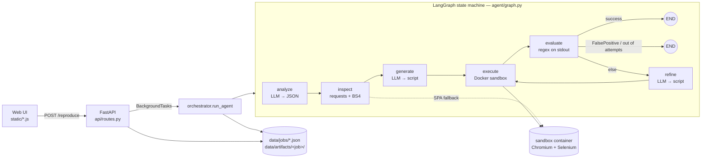

# 01 — Project Analysis: AutoRepro (Bug_Reproducer)

> Scope: full read of every tracked file on `main` at commit `76ea269`, plus running the test suite and
> probe scripts against the real code (Python 3.13, deps from `requirements-dev.txt`, `LLM_PROVIDER=mock`,
> `DEMO_MODE=true`). Docker was **not** available in the analysis environment, so sandbox behaviour is
> assessed by reading the code.

---

## 1. What the project is

AutoRepro takes a **natural-language bug report + a target URL** and autonomously produces a
**Selenium script that proves the bug exists**. It's an LLM agent loop (LangGraph) behind a FastAPI
service, with a vanilla-JS dashboard. Generated scripts run in a throwaway Docker container with headless
Chromium.

The core idea is good and clearly stated: *"reproducing a bug" means proving the bad behaviour is
present*, not testing the happy path. The prompts are written around that idea.

## 2. Architecture

### Modules

| Layer | Files | Responsibility |
|---|---|---|
| API | `api/main.py`, `api/routes.py`, `api/schemas.py` | App factory, CORS, static hosting, 6 endpoints, Pydantic request validation |
| Agent | `agent/graph.py`, `agent/orchestrator.py`, `agent/state.py` | Graph wiring and routing, job lifecycle, `AgentState` TypedDict |
| Nodes | `agent/nodes/{analyze,inspect,generate,execute,evaluate,refine}.py` | The 6 pipeline stages |
| Prompts | `prompts/{analyze,generate,refine}.txt` | `str.format` templates |
| Sandbox | `sandbox/runner.py`, `security.py`, `feedback_parser.py`, `Dockerfile` | Container lifecycle, AST deny-list, log → result normalisation |
| Storage | `storage/jobs.py`, `storage/artifacts.py` | JSON-file job store (atomic replace), per-job artifact dirs |
| LLM | `utils/llm.py`, `utils/bedrock.py`, `utils/mock_llm.py` | Provider factory (bedrock, anthropic, google, ollama, openai, mock), `auto` probe chain, Bedrock Converse→legacy fallback, OpenAI-on-Bedrock adapter |
| Frontend | `static/index.html`, `app.js`, `style.css` | Single page: submit form, polling, result card, history list, lightbox |
| Ops | `Dockerfile`, `docker-compose.prod.yml`, `autorepro/docker-compose.yml`, `setup.sh`, `flamegraph.sh` | API image, prod compose, EC2 bootstrap, macOS profiling |

### Request lifecycle

1. `POST /reproduce` validates `bug_report` (≥20 chars) and `target_url` (`HttpUrl`), writes
   `data/jobs/<uuid>.json` with `status=processing`, and schedules `run_agent` as a Starlette background
   task (it runs in the threadpool, in the API process).
2. `run_agent` calls `compiled.invoke(initial_state)`, which blocks until the graph finishes. **Nothing is
   persisted in between.** The job file is rewritten once, at the very end.
3. The UI polls `GET /result/{id}` every 3 s. While processing, the API returns only `{job_id, status}`.
4. When the job is done, the API reads the JSON, globs `*.png` in the artifact dir, concatenates
   stdout/stderr across attempts, and returns the result.

### State model

`AgentState` is one flat dict that each node copies and returns in full (`{**state, ...}`). `history`
accumulates `{attempt, script, result, refinement_note}`. The whole state, including every script,
stdout, the DOM context and the analysis, is written to the job JSON, and `GET /jobs` returns all of it
for every job.

### LLM usage per job

| Stage | LLM? | Temperature |
|---|---|---|
| analyze | yes (≤2 calls on JSON parse failure) | 0 |
| inspect | no (HTTP, optional sandbox render) | — |
| generate | yes (≤2 calls on syntax error) | 0.2 |
| execute / evaluate | no | — |
| refine | yes, 1 per retry | 0.3 |

With `MAX_ATTEMPTS=5` the worst case is 1 analyze + 1 generate + 4 refine calls (more if parse retries
happen). In `auto` mode each temperature makes its own one-off "Reply with OK" probe.

## 3. Code metrics

| Metric | Value |
|---|---|
| Application Python (excl. tests) | ~1,716 LOC |
| Test Python | ~609 LOC, 26 tests, all passing (0.36 s) |
| Frontend | 150 HTML + 413 JS + 739 CSS lines |
| Commits / contributors | 35 commits, 3 authors, 2026-02-28 → 2026-03-09 |
| CI | none |
| Type checking / lint config | none |

## 4. Strengths

- **Clear problem framing.** The "prove the bug exists" contract runs consistently through the analyze,
  generate and refine prompts.
- **Sensible pipeline decomposition.** Three of the six stages are deterministic and free (no LLM),
  which keeps cost down.
- **DOM grounding.** Feeding real selectors into the prompt is the right way to cut hallucinated
  selectors. The SPA fallback through the sandbox is a thoughtful touch.
- **Provider abstraction.** Five real providers, a mock, and pragmatic Bedrock work-arounds (reasoning
  content blocks, OpenAI-on-Bedrock through `InvokeModel`), with unit tests for the fallback logic.
- **Sandboxing intent.** Non-root user, memory and CPU limits, read-only script mount, and the container
  is always removed in a `finally`.
- **Atomic job writes** (`tmp` + `os.replace`).
- **Documentation effort.** The README is long, with provider setup, an endpoint table and
  troubleshooting.

## 5. Weaknesses (summary; details in [02-bug-analysis.md](02-bug-analysis.md))

1. **The verdict contract is fragile.** Success is a loose regex over the whole of stdout, which also
   carries echoed page text and step logs. This produces false "Bug Reproduced" results on crashed scripts.
2. **The refine loop rarely runs.** The most common first-attempt failure ("Bug not reproduced") is
   classified as `FalsePositive`, which ends the job at once.
3. **Fail-fast on the wrong things.** A DOM inspection error, or a fenced-JSON response from analyze,
   kills the job with zero attempts.
4. **No live progress or durability.** State is written only at the end, a restart leaves jobs in
   `processing` forever, and an exception discards all attempt history.
5. **Security is the main risk for the public EC2 deployment.** There's no auth, `CORS *`, SSRF through
   inspect, a deny-list scanner that can be bypassed, a sandbox with full network egress, and the Docker
   socket mounted into the API container.
6. **The production deployment can't work as committed.** The template file is missing, the bind-mount
   paths are wrong inside the container, and the `host.docker.internal` rewrite breaks inside the
   container.
7. **Weak tests.** Most "bug fix" tests grep source code for strings instead of checking behaviour, and
   there is no CI.

## 6. Scorecard

| Dimension | Score (1–5) | Note |
|---|---|---|
| Concept / product idea | 4.5 | Valuable and well-scoped |
| Architecture | 3 | Clean node split; synchronous in-process execution and file storage limit it |
| Correctness | 2 | Several verified false-positive and false-negative paths in the core verdict |
| Security | 1.5 | Acceptable on localhost, unsafe on the public internet |
| Reliability / ops | 2 | No durability, no queue, deployment config broken |
| Testing | 2 | 26 tests, mostly string greps; no behavioural, API or e2e tests |
| UX | 2.5 | Looks polished, but hides errors and progress and mislabels failed jobs |
| Docs | 3.5 | Thorough, but some claims don't match the code (health check, template, tests) |

See [03-upgrade-roadmap.md](03-upgrade-roadmap.md) for how to move each score up, and
[04-missing-capabilities.md](04-missing-capabilities.md) for the main gaps as a product.
