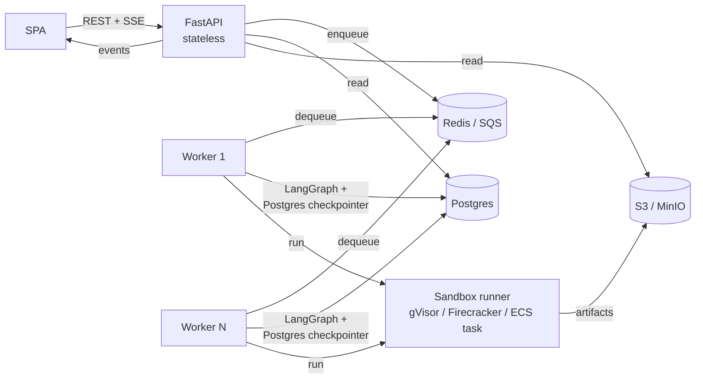

# 03 — Upgrade Roadmap

The roadmap is ordered so that each phase is useful on its own and unblocks the next. Effort estimates
assume one engineer who knows the codebase.

```mermaid
gantt
    dateFormat  X
    axisFormat  %s
    section Phase 0 Stabilise
    Verdict contract + loop fixes      :p0a, 0, 3
    Fail-soft pipeline + persistence   :p0b, after p0a, 3
    Behavioural tests + CI             :p0c, 0, 4
    section Phase 1 Secure
    Auth, rate limits, SSRF guard      :p1a, after p0b, 4
    Sandbox hardening + egress proxy   :p1b, after p0b, 5
    section Phase 2 Re-architect
    Queue + workers + Postgres + S3    :p2a, after p1a, 10
    Live progress (SSE)                :p2b, after p2a, 3
    section Phase 3 Product
    Playwright + traces + video        :p3a, after p2b, 8
    Integrations (GitHub/Jira/Slack)   :p3b, after p2b, 6
    section Phase 4 AI quality
    Eval benchmark + structured output :p4a, after p0c, 8
    Agentic browsing                   :p4b, after p3a, 10
```

---

## Phase 0: Stabilise the core (≈1–2 weeks)

Goal: when AutoRepro says "Reproduced", it's true, and when it fails, the user knows why.

| # | Change | Fixes |
|---|---|---|
| 0.1 | **Structured verdict protocol.** Scripts print exactly one line, `AUTOREPRO_RESULT {"reproduced": bool, "variant": str, "evidence": str}`. Evaluate parses only that line and requires `exit_code == 0`. Page text goes to `print("PAGE:", …)`, which is excluded. | B01–B03 |
| 0.2 | **Re-route "not reproduced" to refine.** Add a `bug_absent` verdict that ends the loop only when the refine LLM explicitly concludes it after ≥2 distinct strategies. | B04 |
| 0.3 | **Fail-soft inspect.** Never raise. Capture HTTP status and body even for 4xx/5xx (those are evidence), and fetch through the sandbox so the network view matches execution. | B05, D01 |
| 0.4 | **Structured LLM output.** `with_structured_output(Analysis)` for analyze, and a `{"note": …, "script": …}` schema or tool call for generate and refine, plus an `ast.parse` + retry loop shared by both. | B06, B13 |
| 0.5 | **Stream the graph and persist after every node** (`compiled.stream(..., stream_mode="updates")`). Merge records instead of replacing them, set `recursion_limit` from `MAX_ATTEMPTS`, and keep history on exceptions. | B07, B09, B10, B16 |
| 0.6 | Return `error`, `stage`, per-attempt summaries and `analysis` from `/result`. Add `/jobs?summary=1` with sorting and pagination. | B08, B22 |
| 0.7 | Remove `_safe_val`, fix `_fix_url` (host-only rewrite), and deduplicate the helpers (`_extract_text`, `_fix_url`, classification) into `agent/common.py`. | B11, B12, B14 |
| 0.8 | Per-attempt artifact directories plus a manifest, with natural sort. | B15 |
| 0.9 | Replace the source-grep tests with behavioural ones (evaluate truth table, classifier table, routes via `TestClient`, end-to-end with `MockLLM` + a fake runner). Add **GitHub Actions**: ruff, mypy, pytest, docker build. | T01 |
| 0.10 | Fix the demo page (B18), and make `DEMO_MODE` honest or wire up `_local_run` (B17). | B17, B18 |

## Phase 1: Make it safe to expose (≈1–2 weeks)

| # | Change |
|---|---|
| 1.1 | **AuthN/AuthZ.** API keys or OAuth (GitHub/Google), jobs scoped to a user or org, and `CORS` restricted to the UI origin. |
| 1.2 | **Quotas.** Per-user rate limiting (`slowapi`), a global concurrency semaphore for sandboxes, and a per-job LLM token and cost budget. |
| 1.3 | **SSRF guard.** Resolve DNS and reject private, loopback, link-local and metadata ranges unless an admin allow-list opts in. Re-check after redirects. Keep TLS verification on. Enforce IMDSv2 on EC2. |
| 1.4 | **Sandbox hardening.** `cap_drop=["ALL"]`, `read_only=True` + tmpfs, `pids_limit`, `security_opt=["no-new-privileges"]`, a seccomp profile, and the gVisor (`runsc`) runtime. A per-job network with egress only to the target host through a proxy. |
| 1.5 | **Remove the Docker socket from the API.** Use a separate runner service (or a socket proxy limited to container create, start, wait and remove). The API runs as non-root. |
| 1.6 | Treat the AST check as lint. Switch it to an **allow-list** of imports (`selenium.*`, `time`, `re`, `json`, `datetime`) instead of a deny-list. |
| 1.7 | Delimit untrusted page content in prompts and tell the model it's data. Strip scripts and comments from the DOM context. |
| 1.8 | Secrets: commit `.env.production.template`, never commit real hostnames, add `gitleaks` to CI. |

## Phase 2: Production architecture (≈2–4 weeks)

- **Job queue + workers** (arq / Celery / RQ, or SQS + ECS tasks). The API stops doing work in-process,
  restarts no longer orphan jobs, and workers scale horizontally.
- **Postgres** for jobs, attempts, users, projects and audit, with Alembic migrations. Use
  `langgraph-checkpoint-postgres` so a crashed job can **resume** from the last node.
- **Object storage** (S3/MinIO) for screenshots, scripts, traces and videos, served via signed URLs.
- **Live progress over SSE/WebSocket**: node start and finish, attempt N, tokens used.
- **Observability**: OpenTelemetry traces per node, LangSmith or Langfuse for LLM calls, Prometheus
  metrics (job duration, success rate, attempts and cost per job), and Sentry.
- **Config**: `pydantic-settings` with validation in place of module-level `os.getenv`.
- **Packaging**: `pyproject.toml` (uv), Python 3.12+, pinned lockfile, Renovate.
- **Dependencies**: move from langchain-core/langgraph `0.2.x` to the current 1.x line. Pin Chromium and
  chromedriver together with the Selenium version, or move to Playwright's versioned images.
- **Deploy**: fix both compose files (D01–D04), a Helm chart or ECS task definitions, HTTPS through a
  reverse proxy (Caddy/Traefik), and a `/health` that actually checks Docker and the LLM.

## Phase 3: Product features (≈3–6 weeks)

1. **Playwright instead of Selenium.** Auto-waiting cuts flakiness. It records **traces** (DOM
   snapshots, network, console) and **video** natively, and has first-class network interception.
   Traces turn "proof of execution" from four PNGs into a scrubbable timeline.
2. **Authenticated targets.** A per-project credential vault, login recipes, and cookie or session
   injection. Most real bugs are behind login.
3. **Flakiness and confidence.** Re-run a successful script N times and report a reproduction rate
   (e.g. "reproduced 5/5"). Run it against a "fixed" build to confirm a fix.
4. **Minimisation.** After success, ask the LLM to shorten the script to the minimal steps, and
   re-verify.
5. **Exports.** A pytest + Playwright test file, a GitHub Actions snippet, and a cURL/HAR for API-level
   bugs. "Copy as regression test" is the killer feature.
6. **Integrations.** Create from a GitHub, Jira or Linear issue (webhook or bot command), and post the
   result back with script, video and verdict. Slack notifications.
7. **Richer inputs.** Attach a screenshot or screen recording, console logs, HAR files, and browser and
   viewport settings (mobile emulation, locale, dark mode).
8. **Multi-browser matrix.** Chromium, Firefox and WebKit, plus viewport presets.
9. **Projects and environments.** Base URLs per environment (staging, prod), saved selectors, shared
   reproduction library, and a diff between runs.
10. **UI**: per-attempt drill-down, a stage timeline, a diff of the script between attempts, a trace
    viewer, re-run and cancel buttons, search and filters, and dark and light themes. A first version is
    on the `ui-uogrades` branch.

## Phase 4: AI quality (ongoing)

- **An evaluation harness first.** Build a benchmark of 30–100 small buggy apps (login, forms, SPA tabs,
  pagination, race conditions, 500 pages), each with a ground-truth "bug present / absent" label. Track
  precision and recall of the verdict, attempts, cost and latency per model and prompt version. Without
  this, prompt changes are guesswork (the git history shows many "bug2" iterations).
- **Agentic browsing instead of one-shot scripts.** Give the model tools (`navigate`, `click`, `type`,
  `read_accessibility_tree`, `screenshot`) and let it explore, then **compile** the successful trajectory
  into a deterministic script. This handles multi-page flows the static DOM snapshot can't see.
- **Use the accessibility tree** (roles and names) instead of truncated raw tags for grounding, and
  prefer role or text locators over CSS IDs.
- **Vision checks** on screenshots for visual bugs (layout, overlap, wrong image).
- **Model updates.** The README recommends older Claude 3.x model IDs on Bedrock, several of which have
  been deprecated or retired. Make the model configurable per stage (a cheap model for analyze, a
  strong model for generate and refine), and add prompt caching for the large static prompt prefix.
- **Cost accounting**: record tokens per call and show cost per job in the UI.
- **Prompt management**: version prompts, A/B them against the benchmark, and keep them out of
  `str.format` (use Jinja with autoescape disabled, and no brace escaping hacks).

---

## Quick wins (≤1 day each)

- [ ] Structured verdict line + exit-code check (B01–B03)
- [ ] `"not reproduced"` → refine (B04)
- [ ] Strip code fences in analyze (B06)
- [ ] Merge job records instead of overwriting them (B07); return `error` (B08)
- [ ] `recursion_limit` (B09)
- [ ] Delete `_safe_val` (B11)
- [ ] UUID validation on job IDs, and no `mkdir` on reads (B21)
- [ ] Commit `.env.production.template`, add `HOST_DATA_DIR` + `extra_hosts` to the prod compose (D01, D02)
- [ ] GitHub Actions running `pytest` with `LLM_PROVIDER=mock`
